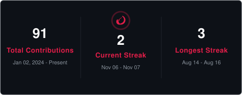

# Assalamu Alaikum 👋, I'm Munzeer Mahamud Runi

**I solve problems, ship products, and teach machines to think.**

---

## 🧑‍💻 About Me

I'm Munzeer, a 3rd-year CSE student at **CUET**, Chittagong, who ended up starting a company, doing research, and competing in programming contests, mostly by chasing whatever problem seemed most interesting at the time.

- 🏢 Co-Founder of **[Xenzolve](https://www.xenzolve.com)**, a software agency building web, automation, and AI workflow solutions
- 🌱 Currently learning **Machine Learning, Deep Learning & LLM Applications**
- 💬 Ask me about **Competitive Programming, Full-Stack Development, AI & Machine Learning**
- 📍 Chattogram, Bangladesh
- ⚡ Fun fact: **I put the "pro" in procrastination.**

---

## 🏆 Achievements

- **Codeforces**: Specialist, 833 problems solved, 77-day max streak
- **LeetCode**: Knight, top 8.34%, 549 problems solved, 127-day max streak, 17 badges
- **Top 20 nationwide** at the BUET hackathon

---

## 🛠️ Skills & Technologies

| Category | Technologies |
| :--- | :--- |
| **Languages** |  &nbsp;  &nbsp;  &nbsp;  &nbsp;  &nbsp;  &nbsp;  &nbsp;  &nbsp;  &nbsp;  &nbsp;  |
| **Frontend & Mobile** |  &nbsp;  &nbsp;  &nbsp;  &nbsp;  &nbsp;  |
| **Backend & APIs** |  &nbsp;  &nbsp;  &nbsp;  &nbsp;  &nbsp;  |
| **Databases & Cloud** |  &nbsp;  &nbsp;  &nbsp;  |
| **AI & Machine Learning** |  &nbsp;  &nbsp;  |
| **Tools & Platforms** |  &nbsp;  &nbsp;  &nbsp;  |
| **Other** |     |

---

## 📊 GitHub Stats

---

## 📫 Connect With Me

