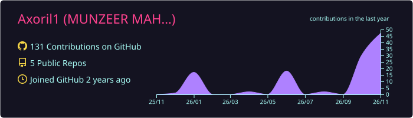
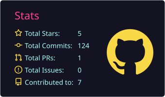
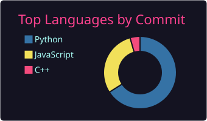
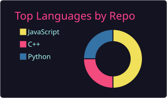

# Assalamu Alaikum 👋, I'm Munzeer Mahamud Runi

**I solve problems, ship products, and teach machines to think.**

---

## 🧑‍💻 About Me

I'm Munzeer, a 3rd-year CSE student at **CUET**, Chittagong, who ended up starting a company, doing research, and competing in programming contests, mostly by chasing whatever problem seemed most interesting at the time.

- 🏢 Founder of **[Xenzolve](https://www.xenzolve.com)**, a software agency building web, automation, and AI workflow solutions
- 🌱 Currently learning **Machine Learning, Deep Learning & LLM Applications**
- 💬 Ask me about **Competitive Programming, Full-Stack Development, AI & Machine Learning**
- 📍 Chattogram, Bangladesh
- ⚡ Fun fact: **I put the "pro" in procrastination.**

---

## 🏆 Achievements

- **Codeforces**: Specialist, 833 problems solved, 77-day max streak
- **LeetCode**: Knight, top 8.34%, 549 problems solved, 127-day max streak, 17 badges
- **Top 20 nationwide** at the BUET hackathon

---

## 🚀 Projects

| Project | What it is | Links |
|---|---|---|
| **PhotoCollect** | QR-based group event photo sharing. Guests scan a code and upload to a live shared gallery, with bulk zip downloads and social sharing. Express 5, MongoDB Atlas, React, Vite, Tailwind | [Live](https://photo-collect-three.vercel.app/) · [Repo](https://github.com/Axoril1/PhotoCollect) |
| **EduXolve** | AI-powered learning platform built for Hackathon 2026: semantic search over course materials, an AI assistant ("Xolve"), and generated study guides. React 19, Firebase, Node/Express, MongoDB, Gemini | [Live](https://eduxolve.web.app/) |
| **CodeScan AI** | AI code review app on the MERN stack using Gemini 2.0 Flash | [Live](https://code-scan-ai.vercel.app/) |
| **EduPortal** | Smart LMS team project. React, Node/Express, TypeScript, MongoDB | [Live](https://edu-portal-01-thunderstorm009s-projects.vercel.app/) |
| **Xenzolve** | Software agency I founded: web development, automation, and AI workflows for small businesses (clinics, salons, tutoring centers, gyms) | [Website](https://www.xenzolve.com) |
| **Restaurant Menu QR** | Xenzolve product: scan a QR at the table for a digital menu, with optional in-app ordering to the kitchen | Coming soon |
| **SkillForged** | Tracks what you learn, pushes progress to GitHub, and builds a resume from that activity | Coming soon |
| **Porikroma** | A travel management system | [Repo](https://github.com/Axoril1/Porikroma_SWE) |

---

## 🛠️ Skills

### Languages

          

### Frontend, Mobile & Frameworks

     

### Backend & APIs

     

### Databases & Cloud

   

### AI & Machine Learning

  

### Tools

   

### Other

---

## 📊 GitHub Stats

### 🐍 Contribution Snake

---

## 📫 Connect With Me

